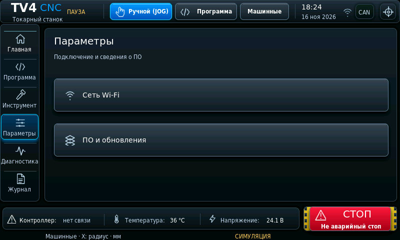
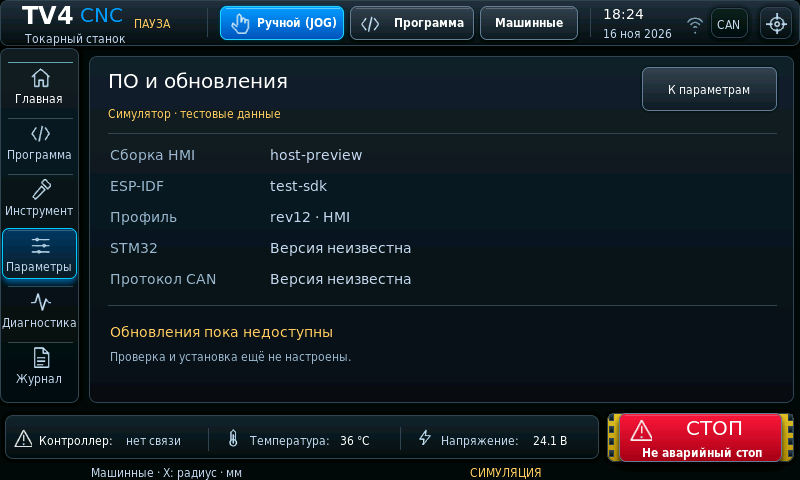

# PR-08a — «ПО и обновления»: локальные сведения

Задание от20ноября2026. База main `b56986f`, PR #1–34 слиты; пять main
workflow PASS. [План](plans/PR08A_FIRMWARE_INFO.md),
[проверки](evidence/build/firmware-info/README.md).

## Поведение

«Параметры» в левой панели и шестерёнка открывают два раздела: «Сеть Wi-Fi»
и «ПО и обновления». Значок Wi-Fi в шапке сохраняет прямой переход к сети.
Кнопка «К параметрам» возвращает из сведений о ПО в меню. Новые touch targets:
669×66 и135×44px. Экран800×480, прежняя тёмная тема и постоянный STOP/status bar.

Показываются текущая **сборка HMI**, ESP-IDF и профиль сборки. На ESP32 значения
однократно берёт app_main из локального `esp_app_get_description()` и compile
configuration, после dashboard_create. Это доступ к descriptor текущего image
в памяти: нет network/partition scan/NVS/Flash writes, verifier/session/installer
вызовов или worker request. IDF builtin esp_app_format указан явно; внешние
зависимости/версии/locks прежние.

Сборка — строка Git/project display version, **не утверждённый SemVer release**
и не trusted installed context для OTA. Нет загрузки remote manifest, ключей,
release channel, изображений прогресса или фиктивной истории. Проверка и установка
помечены как ещё не настроенные; кнопки, изображающие эти операции, отсутствуют.

STM32 и production CAN version показывают «Версия неизвестна». Локальные
software prototypes/heartbeat v1, draft counters и peer historical outcome не
превращаются в известную версию контроллера или разрешение установки/движения.
Отсутствие версии не означает выполненный scan или новый вывод о physical link.

## Provenance и ограниченный snapshot

`core/firmware_info` —72bytes, build/SDK по32bytes включая NUL, явные origin
UNKNOWN/DEVICE/SIMULATOR и compile profile. Не содержит peer data/credentials,
release candidate, ключей или readiness флагов. Это не криптографическое доверие.

Поля копируются из bounded spans, максимум31 printable ASCII bytes. Invalid/
empty/unterminated/oversize/nonprintable поля или неизвестные origin/profile
очищают весь snapshot; silent truncation нет. Caller-owned data копируются,
alias прежних строк поддержан. LVGL owner принимает/валидирует snapshot после
dashboard_create; NULL очищает сведения. Никакого обмена этим struct между
worker/ISR и UI без будущего отдельного согласованного snapshot/queue contract.

Preview явно пишет «Симулятор · тестовые данные», `host-preview`/`test-sdk`;
это не снимок установленной платы или новая hardware evidence. Runtime device
показывает «Локальные данные HMI». Неизвестные исходные сведения не получают
вымышленные default SDK/firmware versions.

## Владение памятью и UI

Callbacks только запрашивают navigation. Новые панели создаёт LVGL owner в
dashboard_update по требованию, а при выходе удаляет и очищает указатели.
Обычный dashboard и Wi-Fi не удерживают эти widgets. На rev12 ELF новые глобальные
snapshot/handles —72+28+4=104bytes; это не весь RAM/stack/heap budget приложения.
Нет дополнительного image/framebuffer/workspace, PSRAM/DMA/PCLK/stack настройки
не менялись. Пользовательское открытие страницы всё ещё требует LVGL heap;
новые физические OOM/CPU/latency/soak измерения не выполнялись.

В host LVGL builtin pool64 циклов меню→ПО→назад→главная возвращают одинаковые
free bytes и исходное число объектов. Обновление сведений не меняет модель
осей/шпинделя/связи, navigation не снимает fault. При уходе из Wi-Fi закрывается
editor и очищается password textarea прежним lifecycle; секреты не попадают на
страницу ПО. Никаких restore/flash/CAN действий.

## Проверки и следующий этап

Host/LVGL30/30 и ASan/UBSan/LeakSanitizer30/30 PASS; core span/unknown/copy/alias
tests, actual-source analyzer, glyph/bounds/overlap,31-byte strings и все profiles,
XRGB8888/RGB565, keyboard cleanup,64 lifecycle cycles, persistent STOP/fault.
Local SDK6.1.1 headless/rev12 build/config/symbol checks PASS. CI сохраняет8 SDK
profiles и STM32 gates, проверяет linked live metadata/view entry points.

Следом нужны approved local key/version/layout/time context, runtime resource/
load/fault/soak budget и отдельный bounded worker, прежде чем включать «Проверить».
Download/install/rollback/USB migration и independent F407 production metadata/
CAN/recovery остаются открытыми этапами. UI не закрывает эти gates.

После review/merge новая аппаратная проверка UI потребует отдельного exact-image
разрешения. На изолированном rev12 стенде проверить фактические descriptor/profile
строки, переходы/сенсор/клавиатуру/стабильность heap. В этом задании плата не
подключалась, не прошивалась и не сбрасывалась; на ESP32 прежний ordinary8f0d899.
F407 owner SWD/core/Flash1024KiB/backup facts прежние; full marking/HSE/RAM/CCM/
erase/protection/GPIO/CAN/restore ещё неизвестны. Flash адреса не резервируются.

Откат — revert PR: меню параметров вернётся к прежнему прямому Wi-Fi. Никаких
новых NVS schemas, runtime updater state, ключей или изменений разметки нет.

