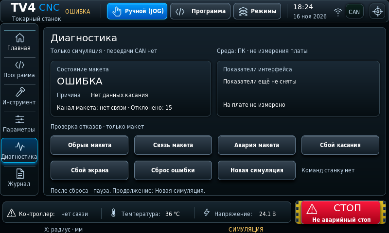
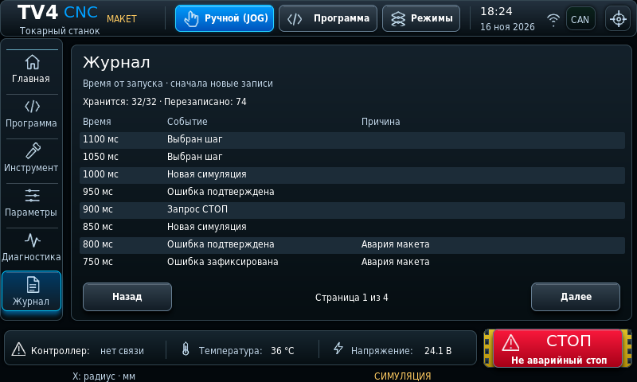

# ПО: диагностика и журнал

План: добавить ограниченный журнал в RAM с причинами ошибок; сделать рабочую
навигацию Главная/Диагностика/Журнал; вывести диагностические снимки и управляемые
отказы симуляции. Не подключаться к плате, не выполнять flash/monitor/backup.

Критерии: причина ошибки сохраняется до ACK, ACK не запускает движение;
повторяющийся аппаратный отказ не заполняет журнал каждую итерацию;
журнал ограничен фиксированной ёмкостью и показывает переполнение;
длинные записи помещаются на 800×480; LVGL меняется только владельцем;
host tests и оба ESP-IDF профиля компилируются.

## Реализовано
- Работают переходы Главная/Диагностика/Журнал через боковое меню.
- Диагностика показывает состояние, причину ошибки, виртуальный канал, отклонённые
  запросы и показатели интерфейса. Среда ПК/ESP32 явно подписана.
- Есть инъекции обрыва/подключения канала макета, аварии, ошибок касания/дисплея.
  Эти кнопки не обращаются к драйверам; это события модели симуляции.
- ACK оставляет HOLD; отдельная Новая симуляция разрешена только после HOLD
  без текущей ошибки. История и счётчик отклонений при этом сохраняются.
- Журнал в RAM: 32 записи, время uint32 ms от запуска (с оборачиванием), тип
  события и причина; восемь строк на странице, четыре страницы, сначала новые.
  Повтор одной причины в FAULT не добавляет запись каждый цикл.
  Старые записи вытесняются, число вытеснений отображается. После перезапуска
  питание/процесс история не сохраняется; это не производственный аудит станка.
- Переполнение UI-очереди и неизвестное событие имеют разные причины ошибок,
  потерянные события учитываются в счётчике отклонённых запросов.

## Проверка
Host core/render/render_rgb565: 3/3. Пройдено переполнение кольца, сохранение
причины, отсутствие автозапуска после ACK, отдельный запуск новой симуляции,
повторы одного отказа, клики настоящих кнопок, переходы всех трёх экранов,
таймаут канала и перелистывание до обеих границ журнала. Компоновка всех
экранов проверена программно и визуально. Кадры созданы настоящим LVGL.
Счётчики на кадрах получены из детерминированного тестового сценария.

Плата не подключалась, flash не читалась/не записывалась. Ожидание сообщения
пользователя о backup сохраняется. Навигация Программа/Инструмент/Параметры
и верхние вкладки пока не реализованы.
