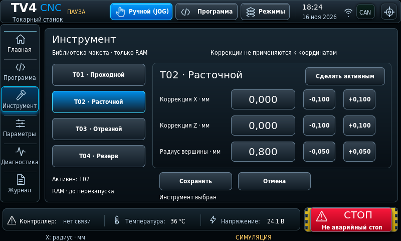
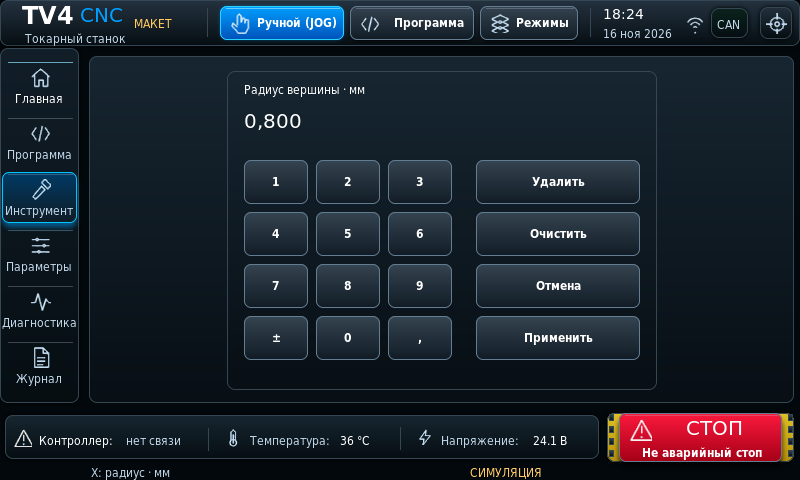

# ПО-003: библиотека инструмента

План: фиксированная библиотека четырёх резцов в RAM, транзакционное сохранение
геометрии, отдельный выбор активного инструмента, черновик и числовая клавиатура.
Критерии: неверный ввод не меняет сохранённые параметры; отмена возвращает
черновик; сохранение/выбор запрещены при FAULT или подключённом канале макета;
координаты/подача не меняются от смены инструмента; новые экраны проходят
проверку компоновки и сборку двух ESP-IDF профилей. Без подключения к плате.

## Реализовано
Четыре ячейки с условными именами и кодами резцов, активный инструмент и
редактор X/Z-коррекций (радиусное представление X, мм) и радиуса вершины.
Параметры демонстрационные, не измерения реальных резцов. Пределы формата:
X/Z ±1000 мм, R 0...5 мм; это программные границы макета, не допуски станка.

Кнопки изменяют X/Z на 0,100 мм, R на 0,050 мм; величины шага подписаны.
Нажатие значения открывает клавиатуру. Парсер принимает точные десятичные
числа с запятой/точкой, до трёх знаков после разделителя; отклоняет экспоненту,
пробелы, NaN, переполнение и лишние дробные знаки. Ничего не округляется.

Редактирование происходит в черновике. Применить закрывает клавиатуру,
Сохранить атомарно сохраняет три параметра. Отмена клавиатуры отменяет только
текущий ввод, Отмена редактора — весь черновик. Пока есть черновик, другой
резец не открывается и не активируется без сохранения/отмены. Изменившаяся
сохранённая запись не перезаписывается молча устаревшим черновиком.

Сделать активным — отдельная команда, без движения и применения коррекций.
При FAULT/подключённом канале макета сохранение и выбор активного запрещены.
Новая симуляция сохраняет библиотеку/активный резец. Питание/перезапуск
процесса сбрасывают библиотеку к демонстрационным данным: NVS ещё не используется.
Сохранение/выбор попадают в журнал. На Главной обновляются номер, имя, код
и радиус выбранного инструмента; X/Z, RPM и подача от выбора не меняются.
Ø32 и размер 0.200 в карточке Главной остаются условными значениями образца.

## Проверки
Core + два рендера LVGL: 3/3. Проверены крайние int32, неправильные числа,
атомарность сохранения, ограничения диапазона, запреты FAULT/канала макета,
черновик/отмена, клавиатура, неверный ввод без закрытия клавиатуры, возврат
к сохранению после ACK, смена активного без изменения X/Z и карточка Главной.
Компоновка и наличие настоящих глифов без квадратов проверены по всему
видимому дереву LVGL, в том числе на новых экранах. Оба профиля ESP-IDF собраны.

Плата не подключалась, операции backup/flash/monitor не выполнялись.
