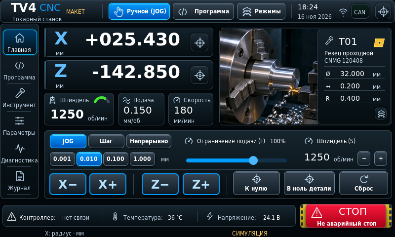

# Интерфейс по пользовательскому референсу

Обновлён реальный экран LVGL 9.2.2, 800×480. Это рендер приложения на ПК,
не изображение сгенерированного интерфейса и не фото работающей платы.

Восстановлены пропорции референса: верхняя панель, узкое меню слева,
две большие координатные карточки, три блока показаний, фотографическая
иллюстрация обработки и отдельная карточка резца справа, переключатели шага,
шкала подачи, четыре осевые кнопки и три нижние команды, нижняя телеметрия
и красная кнопка остановки. Добавлены собственные контурные значки,
полужирные цифры, тонкие границы, градиенты и голубое свечение активных элементов.

Начальные значения макета: X +025.430, Z −142.850, 1250 об/мин,
0.150 мм/об, 180 мм/мин, шаг 0.010 мм. Это условные данные, не показания
контроллера. Температура, напряжение, время, дата и размеры резца — также примеры.
Постоянная маркировка «СИМУЛЯЦИЯ» сохранена. Готовность машины не заявляется.

Функциональны только четыре направления в симуляции, выбор шага,
сброс в HOLD и экранный СТОП. Остальные разделы, режимы, нулевые команды,
ползунок и задание шпинделя — пока неактивные визуальные элементы.
Размеры небольших кнопок шага дополнены расширенной зоной касания.
При остановке/ошибке показания шпинделя/подачи переходят в ноль.
Экранный СТОП не является аппаратным аварийным остановом.

Проверка: сборка GCC/CMake/Ninja с LVGL 9.2.2 выполнена;
CTest core и render — 2/2 успешно. Проверены реальные обработчики LVGL,
шрифт А–я, Ё/ё и знаки Ø/↔, переполнение очереди и сброс без перезапуска.
Рендер проверен визуально. Совместимость ESP-IDF/BSP Rev 1.2 и работа
на физическом дисплее по-прежнему не подтверждены.

Иллюстрация создана встроенным image_gen; полный промпт и описание
сохранены в firmware/esp32-hmi/assets/IMAGE-PROVENANCE.md внутри архива проекта.
Это новая иллюстрация в стиле образца; пиксельное совпадение с исходным фото
и шрифтами референса не заявляется.

## Свет, шрифт и объём кнопок

Усилены нижние мягкие тени, верхний блик и границы кнопок.
Активные кнопки получили насыщенный синий градиент и голубое свечение.
Для подписей кнопок добавлен DejaVu Sans Condensed Bold 12 px,
основной текст — белый, второстепенный — более светлый голубой.
При выборе шага обновляются градиент, контур и свечение.
Проверено рендером LVGL 800×480; CTest 2/2 успешно.

## Компоновка и отступы

Карточки показаний выровнены по общей нижней границе. Значения и единицы
измерения получили отдельные области, индикатор шпинделя отделён от подписи.
Между карточками 8 px; основные группы управления разделены линиями и
отступами. Два верхних ряда управления имеют 8 px между кнопками по вертикали;
нижние осевые команды начинаются после отдельного разделителя. Тени маленьких
кнопок уменьшены, чтобы не залезать на соседние ряды.

В нижней строке подписи и значения разнесены по колонкам. Состояние HOLD
в компактном заголовке обозначается «ПАУЗА», чтобы длинный текст не перекрывал
вкладки. Постоянная маркировка «СИМУЛЯЦИЯ» отделена от кнопки СТОП.

В тест render добавлена независимая проверка дерева LVGL: естественная ширина
каждой подписи помещается в объект, текст не выходит за родителя, подписи
не пересекаются, кнопки не пересекаются и не закрывают чужой текст. Проверены
старт, ошибка, пауза и варианты длинных статусов, включая «НЕТ СВЯЗИ».
Сборка и CTest: 2/2 успешно. Проверка аппаратного дисплея не выполнялась.

Рабочая навигация Главная/Диагностика/Журнал и журнал ошибок описаны в SOFTWARE_STAGE_002.md. Остальные разделы остаются заглушками.

Раздел Инструмент теперь работает: библиотека, черновик, клавиатура и отдельный
выбор активного. Подробнее SOFTWARE_STAGE_003.md. Программа/Параметры и верхние
вкладки пока остаются заглушками.
