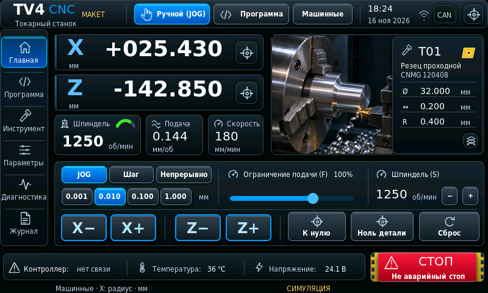

# ESP32: первый кадр HMI до фоновых служб

22 ноября2026. База main973a9ba, PR #1–63 слиты. Firmware source commit
`5e9ae14dd0b74cfdf16e187b8af61f3f8568debe`, clean tree `337f68e65862ab1c6698e91d26a2a2b2748dca62`, app descriptor `5e9ae14`.
Следующий evidence commit меняет только документацию/результаты; локальные
ELF/BIN относятся именно к этому чистому исходному коммиту. CI собирает свой SHA.
Ни устройство, ни UART/SWD/reset/Flash не открывались; на ESP32 fecc05d/factory/
tv4-16m-ab-v1, на F407 ee7d179. Самостоятельных merge/release/keys нет.

## Результат

В actual app_main existing export/Wi-Fi start перенесены после закрытия splash,
полного первого dashboard refresh и UI_READY. Ошибка этого flush блокирует
optional services и обычный main loop. OTA worker/deadline остаются до board
init; свежесть touch, held-touch release, минимальные1200ms splash, polling и
основной цикл сохранены. Wi-Fi init/scan/connect/NVS/password logic прежняя;
сеть начинается позже, AP/DHCP не задерживают загрузку HMI. Новых задач,
таймеров, задержек, profiles или runtime abstraction нет.

Startup ID0..6 прежние, хронология `0,1,2,3,5,6,4`. Ledger выводится по ID,
не по времени; `sample_ms` определяет порядок. Исторический fc90200 не менялся.
Не менялись GPIO/Flash map/DMA reserve64KiB/TLS records16384/4096/framebuffer/
PCLK/PSRAM clocks, trust/key/context/floors и существующие protections.

## Программные проверки

- Host97/97 и ASan+UBSan+LSan97/97, leak detection включена. В том числе
  существующие UI/boot/Wi-Fi/OTA/STM32/protocol/fault проверки.
- Десять новых actual app_main/real LVGL9.2.2 интеграционных сценариев:
  success, held-touch, board/buffer/backlight/touch/initial-flush/final-dashboard-
  flush failure, export failure, Wi-Fi creation failure. До полного кадра нет
  optional service calls; отказ optional service не мешает main health loop.
  OTA start проверяется до board init; held-touch не переносится в JOG.
- [Cold render comparison](cold-render.json): первый RGB565 кадр до/после
  побайтно одинаков. PPM SHA-256
  `b9e1a7245e9e70de868263d592817fa23a47f9082cc32fc364c709e501dfd4f6`.
- 12/12 clean firmware builds: обе SDK×пять профилей + OTA trace; Flash16MiB,
  expected partition/PSRAM/TLS/config/lock/source-owner/ELF/frame gates PASS.
  [Полные hashes и проверки](matrix.json). Diagnostics data0 в normal profiles,
  trace432bytes≤512; own compiler frame≤112bytes≤192. Это не runtime stack.

| SDK | Profile | App bytes | Diagnostic writable bytes | Max own frame bytes | Result |
|---|---|---:|---:|---:|---|
| 6.1.1 | headless | 1061072 | 0 | 32 | PASS |
| 6.1.1 | rev12 | 1579296 | 0 | 32 | PASS |
| 6.1.1 | rev12-memory-bench | 1580992 | 0 | 32 | PASS |
| 6.1.1 | rev12-tls-bench | 1584176 | 0 | 32 | PASS |
| 6.1.1 | rev12-ota | 1598560 | 0 | 64 | PASS |
| 6.1.1 | rev12-ota+trace | 1600576 | 432 | 112 | PASS |
| 5.3.2 | headless | 1075504 | 0 | 32 | PASS |
| 5.3.2 | rev12 | 1535088 | 0 | 32 | PASS |
| 5.3.2 | rev12-memory-bench | 1536784 | 0 | 32 | PASS |
| 5.3.2 | rev12-tls-bench | 1540064 | 0 | 32 | PASS |
| 5.3.2 | rev12-ota | 1551088 | 0 | 64 | PASS |
| 5.3.2 | rev12-ota+trace | 1553120 | 432 | 112 | PASS |

Host GCC15.2.0/CMake4.2.3/Ninja1.13.2/Python3.14.4, настоящий LVGL9.2.2.
SDK6.1.1 local commit051e4c4eb20346e043cdd47bc388fde75ff8af63, tracked clean,
Xtensa15.2.0/esp-15.2.0_20251204. SDK5.3.2 — pinned official Docker
`espressif/idf@sha256:5b8f58d9d9caa45b689a31a0b6a0cc53b84594e0ba5fdd8d28eeef7d6123242a`,
Xtensa13.2.0/esp-13.2.0_20240530. CI6.1.1 image pin остаётся
`sha256:2b4f966c37eaedc19542b0637a5f850b2eff9478d8e858192aa0073d92c2dc91`.
LVGL9.2.2/touch1.2.1/GT9111.1.3 и оба lock SHA в matrix.json; pins прежние.

## Что установлено трассой, что ещё нет

Host observer перехватывает успешные реальные LVGL malloc/realloc после
lv_init (само создание pool list не наблюдается). Baseline — actual app_main
main973a9ba с тем же новым SDK boundary, не прежний ESP32 binary. Builtin256KiB
pool/64-bit ABI, fake clock/board/network отличаются от ESP32 CLIB allocator,
FreeRTOS, internal/PSRAM placement и реального радио. Поэтому эти числа нельзя
переносить в target RAM budget или считать измерением производительности.

В обоих host runs pool peak181488bytes; largest request после DASHBOARD_READY
14339bytes идёт через lv_draw_layer_alloc_buf → lv_draw_buf_create → lv_malloc.
GUI не уменьшался; после изменения этот cold peak проходит до service start.
Радио/RTOS allocations в doubles отсутствуют. Доказаны порядок и одинаковый
кадр; экономия памяти, Wi-Fi/boot latency и причина hardware minimum1887
этим тестом **не подтверждены**. Новое число ESP32 minimum не заявляется.

На [fc90200](../../hardware/2026-11-22-esp32-ota-memory/README.md) measured
BOOT local1887 и history112 — per-heap minima, не simultaneous free/OOM proof.
Configured worker8192/TLS/install/key/context/floors остаются открытыми; полные
SRAM/PSRAM/stack/FPS/latency/soak/slot confirm/rollback/power-loss/full recovery
не приняты. Следующее exact-image hardware измерение требует отдельного
разрешения; прежний сеанс закрыт. Ни migration, ни ordinary rev12 flash не
являются частью программной проверки.



## Воспроизведение без устройств

```bash
cmake -S . -B build-host -G Ninja -DLVGL_DIR="$PWD/firmware/esp32-hmi/managed_components/lvgl__lvgl"
cmake --build build-host -j4
ctest --test-dir build-host --output-on-failure
# Из build-host: startup_tests audit сохраняет host frame/allocator/order trace.
cmake -S . -B build-sanitize -G Ninja -DLVGL_DIR="$PWD/firmware/esp32-hmi/managed_components/lvgl__lvgl" \
  '-DCMAKE_C_FLAGS=-fsanitize=address,undefined -fno-omit-frame-pointer' \
  -DCMAKE_EXE_LINKER_FLAGS=-fsanitize=address,undefined
cmake --build build-sanitize -j4
ASAN_OPTIONS=detect_leaks=1 ctest --test-dir build-sanitize --output-on-failure
TV4_IDF_PATH="$HOME/.espressif/v6.1.1/esp-idf" ./tools/build_idf.sh rev12-ota 6.1.1 local
TV4_IDF_PATH="$HOME/.espressif/v6.1.1/esp-idf" TV4_OTA_MEMORY_DIAGNOSTICS=1 ./tools/build_idf.sh rev12-ota 6.1.1 local
./tools/build_idf.sh rev12-ota 5.3.2 docker
TV4_OTA_MEMORY_DIAGNOSTICS=1 ./tools/build_idf.sh rev12-ota 5.3.2 docker
```

Для обеих SDK дополнительно собраны headless/rev12/rev12-memory-bench/rev12-tls-bench
тем же build script. CI сохраняет всю прежнюю matrix10jobs+две trace builds,
host/sanitizer suites и новый host startup audit/frame artifact. Обычный push
не публикует release. [План](../../../plans/P1_STARTUP_MEMORY_ORDER.md),
[следующий этап](../../../NEXT_STAGE.md), [сводка проверок](checks.json).
