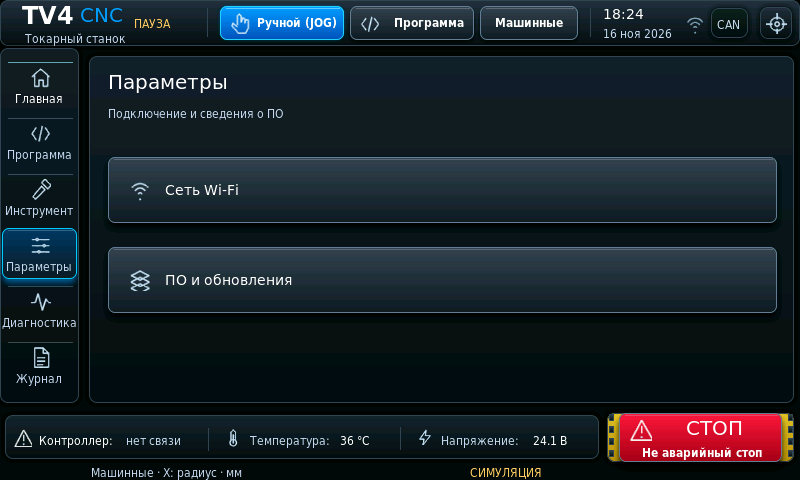
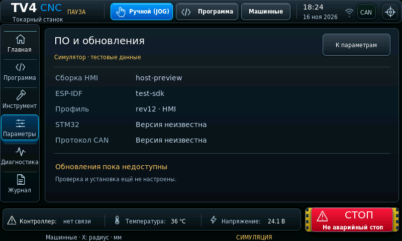

# PR-08a — build/render evidence

Задание20ноября2026, Asia/Almaty. База main
`b56986f8d20fecca1af8125c311e8bb26196f299`, PR #1–34 слиты, пять main workflows PASS.
Проверен modified worktree; source/config/dependency [hashes](source-hashes.json),
[versions](versions.json). [Контракт](../../../FIRMWARE_INFO_UI.md),
[план](../../../plans/PR08A_FIRMWARE_INFO.md).

| Проверка | Результат | Evidence |
|---|---|---|
| Host/LVGL/logic | **30/30 PASS**,2.77s | [CTest](host-ctest.txt), [full log](host-tests.log) |
| ASan/UBSan/LeakSanitizer | **30/30 PASS**,6.25s, без suppressions | [CTest](sanitizer-ctest.txt), [full log](sanitizer-tests.log) |
| Firmware display model | Bounds31/spans/unknown/origin/profile/copy/alias PASS; sizeof72 | [cases](firmware-cases.txt) |
| Real LVGL render | XRGB8888 +RGB565,800×480; glyph/overlap/bounds/long strings/profiles PASS | firmware-cases.txt |
| Lifecycle | **64 cycles per color format**, original object count и identical warmed host-pool free bytes | firmware-cases.txt |
| UI effects | Navigation не меняет axes/spindle/link; fault сохраняется; STOP виден; Wi-Fi editor/password cleanup PASS | firmware-cases.txt |
| Actual GCC15.2.0 -fanalyzer -c | firmware_info PASS, warnings as errors | [static-analysis](static-analysis.txt) |
| SDK6.1.1 headless | **build/config/live symbols PASS**,app1059056bytes,PSRAM disabled | [validation](idf-6.1.1-headless.json), [summary](idf-6.1.1-headless-summary.txt) |
| SDK6.1.1 rev12 | **build/config/live symbols PASS**,app1577216bytes,octal PSRAM80MHz | [validation](idf-6.1.1-rev12.json), [summary](idf-6.1.1-rev12-summary.txt) |
| New global snapshot/handles | **72+28+4=104bytes** in rev12 ELF, not complete runtime RAM budget | [metadata-ram](metadata-ram.json) |

30 =29 main suites +firmware_info; render suites расширены новыми сценариями.
Независимые STM32 motion/startup/transport/crypto/handoff/profile/outcome tests
сохранены и исполнялись в root runs. STM32 source не менялся; новый отдельный
ARM build локально не выполнялся, existing ARM/source/image/output gates в CI.
Все8 SDK profiles6.1.1/5.3.2×4 сохранены; CI дополнительно проверяет live symbols
firmware_info_set/firmware_view_create/dashboard_set_firmware_info. Не выводить
восемь PR CI результатов из двух local builds; смотреть отдельные Checks PR.

Local SDK binary hashes относятся к modifiedb56986f / PROJECT_VERb56986f-dirty,
не production release или exact image approval. В summaries опущены routine
compilation lines, оставлены activation/dependency provenance и success/config
tail; полные local logs сохранены вне Git в outputs, полные CI build logs доступны
в Checks/artifacts. Стандартная подсказка IDF «To flash» не выполнялась.





## Воспроизведение

TV4_LVGL_SOURCE —9.2.2 commit7f07a129e8d77f4984fff8e623fd5be18ff42e74;
TV4_MBEDTLS_SOURCE_ARCHIVE — official3.6.7 archive, SHA в origin.json,
optional cache всё равно проверяется. CI default скачивает тот же archive.

```bash
set -euo pipefail
cmake -S . -B build-host -G Ninja -DLVGL_DIR="$TV4_LVGL_SOURCE" \
  -DTV4_BOOT_MBEDTLS_ARCHIVE="$TV4_MBEDTLS_SOURCE_ARCHIVE"
cmake --build build-host -j4
ctest --test-dir build-host --output-on-failure

cmake -S . -B build-sanitized -G Ninja -DLVGL_DIR="$TV4_LVGL_SOURCE" \
  -DTV4_BOOT_MBEDTLS_ARCHIVE="$TV4_MBEDTLS_SOURCE_ARCHIVE" \
  '-DCMAKE_C_FLAGS=-fsanitize=address,undefined -fno-omit-frame-pointer' \
  '-DCMAKE_EXE_LINKER_FLAGS=-fsanitize=address,undefined'
cmake --build build-sanitized -j4
ctest --test-dir build-sanitized --output-on-failure

TV4_IDF_PATH="$HOME/.espressif/v6.1.1/esp-idf" ./tools/build_idf.sh headless 6.1.1 local
TV4_IDF_PATH="$HOME/.espressif/v6.1.1/esp-idf" ./tools/build_idf.sh rev12 6.1.1 local
```

Render tests сохраняют settings/firmware-info/unknown/long/fault PPM по обоим
color formats. Committed PNG — конверсия RGB565 frames без retouch; version
строки явно test fixtures. Кириллица/Ё/ё проверяются actual fonts/layout checker.
Sanitizers вне ptrace, default options, без ASan/LSan/UBSan diagnostics. Host-pool
assertions не доказывают ESP32 heap/latency/CPU или физический touch response.

Все внешние зависимости/locks/GPIO/PCLK/framebuffer/DMA/stacks/security прежние.
На ESP32 ordinary8f0d899, новых hardware observations нет. Нет device/SWD/UART/
reset/flash/backup reads/CAN/drive outputs, actual F407 memory/Flash map, keys,
release/tag или самостоятельного merge. Аппаратные блокеры сохранены.
